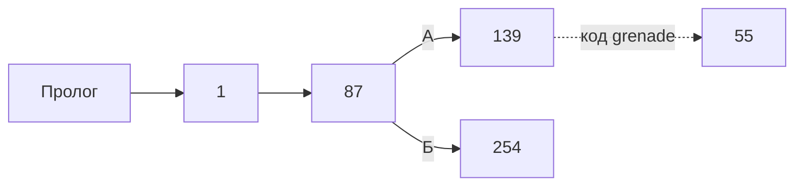

# storyGraph.md

Сцен: 600. Прямых переходов: 953. Выборов: 177. Концовок: 39. Кодов: 44. Достижимо с кодами: 599. Недостижимо: 1.

Граф собран из двух слоёв: **прямые рёбра** (`next`/`variants` в `game.yaml`) и **коды** (`codes.yaml` + `learn_code`). Коды — не рёбра: цель считается как `(base ?? текущая сцена) + offset`, поэтому в таблицу ветвлений они не входят. Раздел «Коды» показывает смещения и базы.

Полный Mermaid-граф на 600 узлов не строится (порог 400–600 из story-graph.md); форма истории видна по таблицам ниже.

## Ветвления

| Сцена | Тип | Выходы |
|---|---|---|
| prologue | линейный | 1 |
| 1 | линейный | 87 |
| 2 | линейный | 224 |
| 3 | выбор | А → 281; Б → 69; В → 37; Г → 187; Д → 568; Е → 227; Ж → 579 |
| 4 | линейный | 320 |
| 5 | выбор | А → 264; Б → 107; В → 166; Г → 358; Д → 425 |
| 6 | концовка | — |
| 7 | линейный | 359 |
| 8 | выбор | А → 176; Б → 377 |
| 9 | линейный | 171 |
| 10 | выбор | А → 32; Б → 336; В → 61; Г → 219; Д → 415; Е → 356; Ж → 230; З → 532 |
| 11 | линейный | 179 |
| 12 | концовка | — |
| 13 | линейный | 274 |
| 14 | линейный | 197 |
| 15 | линейный | 359 |
| 16 | линейный | 358 |
| 17 | линейный | 320 |
| 18 | линейный | 324 |
| 19 | линейный | 107 |
| 20 | выбор | А → 25; Б → 90; В → 157; Г → 342; Д → 120; Е → 100; Ж → 180 |
| 21 | выбор | А → 566; Б → 488; В → 77 |
| 22 | выбор | А → 323; Б → 144; В → 489 |
| 23 | линейный | 171 |
| 24 | линейный | 294 |
| 25 | линейный | 20 |
| 26 | концовка | — |
| 27 | линейный | 379 |
| 28 | линейный | 292 |
| 29 | выбор | А → 592; Б → 64 |
| 30 | выбор | А → 90; Б → 72 |
| 31 | линейный | 56 |
| 32 | выбор | А → 86; Б → 392; В → 164; Г → 349; Д → 10 |
| 33 | линейный | 264 |
| 34 | линейный | 333 |
| 35 | линейный | 320 |
| 36 | выбор | А → 266; Б → 374 |
| 37 | линейный | 3 |
| 38 | выбор | А → 95; Б → 118; В → 366 |
| 39 | выбор | А → 386; Б → 181; В → 48; Г → 302 |
| 40 | линейный | 356 |
| 41 | линейный | 133 |
| 42 | линейный | 226 |
| 43 | линейный | 343 |
| 44 | линейный | 25 |
| 45 | линейный | 77 |
| 46 | выбор | А → 52; Б → 197 |
| 47 | линейный | 464 |
| 48 | линейный | 302 |
| 49 | линейный | 144 |
| 50 | концовка | — |
| 51 | линейный | 493 |
| 52 | линейный | 46 |
| 53 | линейный | 359 |
| 54 | линейный | 330 |
| 55 | линейный | 139 |
| 56 | линейный | 77 |
| 57 | выбор | А → 468; Б → 163 |
| 58 | выбор | А → 144; Б → 294 |
| 59 | линейный | 320 |
| 60 | выбор | А → 152; Б → 335 |
| 61 | выбор | А → 247; Б → 372; В → 10 |
| 62 | линейный | 379 |
| 63 | концовка | — |
| 64 | линейный | 592 |
| 65 | линейный | 294 |
| 66 | линейный | 3 |
| 67 | линейный | 343 |
| 68 | выбор | А → 120; Б → 128; В → 533 |
| 69 | выбор | А → 121; Б → 255; В → 354; Г → 174; Д → 3 |
| 70 | выбор | А → 383; Б → 197 |
| 71 | линейный | 359 |
| 72 | линейный | 20 |
| 73 | линейный | 226 |
| 74 | выбор | А → 109; Б → 185 |
| 75 | выбор | А → 170; Б → 267; В → 270 |
| 76 | линейный | 224 |
| 77 | выбор | А → 396; Б → 117; В → 21; Г → 56; Д → 333; Е → 224; Ж → 495; З → 379; И → 244; Й → 230 |
| 78 | выбор | А → 197; Б → 23; В → 197 |
| 79 | линейный | 100 |
| 80 | линейный | 597 |
| 81 | линейный | 377 |
| 82 | линейный | 77 |
| 83 | линейный | 324 |
| 84 | выбор | А → 279; Б → 326; В → 20 |
| 85 | линейный | 69 |
| 86 | линейный | 32 |
| 87 | выбор | А → 139; Б → 254 |
| 88 | выбор | А → 351; Б → 180; В → 555 |
| 89 | выбор | А → 167; Б → 379 |
| 90 | выбор | А → 25; Б → 72 |
| 91 | линейный | 97 |
| 92 | выбор | А → 152; Б → 357; В → 287; Г → 359 |
| 93 | линейный | 229 |
| 94 | линейный | 464 |
| 95 | выбор | А → 118; Б → 38; В → 366 |
| 96 | выбор | А → 151; Б → 144 |
| 97 | выбор | А → 161; Б → 183; В → 198; Г → 240; Д → 256; Е → 343 |
| 98 | линейный | 11 |
| 99 | линейный | 197 |
| 100 | выбор | А → 113; Б → 134; В → 180; Г → 20; Д → 439; Е → 79 |
| 101 | выбор | А → 344; Б → 224; В → 2 |
| 102 | выбор | А → 204; Б → 97 |
| 103 | выбор | А → 487; Б → 138 |
| 104 | линейный | 11 |
| 105 | линейный | 294 |
| 106 | линейный | 152 |
| 107 | выбор | А → 371; Б → 355; В → 133; Г → 19; Д → 5 |
| 108 | линейный | 320 |
| 109 | линейный | 556 |
| 110 | концовка | — |
| 112 | линейный | 152 |
| 113 | линейный | 100 |
| 114 | линейный | 294 |
| 115 | линейный | 22 |
| 116 | концовка | — |
| 117 | линейный | 77 |
| 118 | выбор | А → 307; Б → 291; В → 313 |
| 119 | линейный | 359 |
| 120 | выбор | А → 305; Б → 552; В → 404; Г → 20 |
| 121 | выбор | А → 304; Б → 69 |
| 122 | линейный | 464 |
| 123 | линейный | 226 |
| 124 | линейный | 3 |
| 125 | линейный | 3 |
| 126 | выбор | А → 100; Б → 339 |
| 127 | линейный | 197 |
| 128 | линейный | 5 |
| 129 | линейный | 343 |
| 130 | линейный | 343 |
| 131 | выбор | А → 376; Б → 320 |
| 132 | линейный | 180 |
| 133 | линейный | 107 |
| 134 | линейный | 100 |
| 135 | линейный | 229 |
| 136 | линейный | 248 |
| 137 | выбор | А → 283; Б → 229 |
| 138 | линейный | 320 |
| 139 | линейный | 254 |
| 140 | линейный | 330 |
| 141 | линейный | 5 |
| 142 | линейный | 49 |
| 143 | линейный | 56 |
| 144 | выбор | А → 96; Б → 49; В → 158; Г → 491; Д → 294 |
| 145 | линейный | 25 |
| 146 | линейный | 3 |
| 147 | концовка | — |
| 148 | выбор | А → 266; Б → 374 |
| 149 | линейный | 171 |
| 150 | линейный | 25 |
| 151 | линейный | 294 |
| 152 | линейный | 92 |
| 153 | линейный | 10 |
| 154 | выбор | А → 64; Б → 29 |
| 155 | линейный | 25 |
| 156 | линейный | 3 |
| 157 | линейный | 20 |
| 158 | линейный | 144 |
| 159 | выбор | А → 373; Б → 251 |
| 160 | линейный | 44 |
| 161 | линейный | 97 |
| 162 | линейный | 379 |
| 163 | концовка | — |
| 164 | линейный | 32 |
| 165 | линейный | 25 |
| 166 | выбор | А → 298; Б → 249; В → 5 |
| 167 | линейный | 379 |
| 168 | линейный | 333 |
| 169 | выбор | А → 81; Б → 107 |
| 170 | выбор | А → 523; Б → 329; В → 75 |
| 171 | выбор | А → 9; Б → 314; В → 149; Г → 197 |
| 172 | выбор | А → 65; Б → 294 |
| 173 | линейный | 282 |
| 174 | линейный | 203 |
| 175 | линейный | 323 |
| 176 | выбор | А → 278; Б → 377 |
| 177 | линейный | 294 |
| 178 | линейный | 154 |
| 179 | выбор | А → 393; Б → 205 |
| 180 | выбор | А → 88; Б → 132; В → 312; Г → 20; Д → 100 |
| 181 | выбор | А → 386; Б → 39; В → 48; Г → 302 |
| 182 | линейный | 264 |
| 183 | линейный | 97 |
| 184 | линейный | 230 |
| 185 | выбор | А → 305; Б → 100 |
| 186 | выбор | А → 293; Б → 359 |
| 187 | линейный | 3 |
| 188 | линейный | 369 |
| 189 | линейный | 96 |
| 190 | линейный | 224 |
| 191 | концовка | — |
| 192 | линейный | 180 |
| 193 | линейный | 81 |
| 194 | линейный | 320 |
| 195 | линейный | 282 |
| 196 | линейный | 294 |
| 197 | выбор | А → 14; Б → 127; В → 361; Г → 318; Д → 320; Е → 230 |
| 198 | линейный | 97 |
| 199 | линейный | 334 |
| 200 | концовка | — |
| 201 | линейный | 359 |
| 202 | линейный | 10 |
| 203 | выбор | А → 153; Б → 69 |
| 204 | линейный | 97 |
| 205 | линейный | 199 |
| 206 | выбор | А → 46; Б → 320 |
| 207 | линейный | 320 |
| 208 | концовка | — |
| 209 | линейный | 249 |
| 210 | линейный | 185 |
| 211 | линейный | 464 |
| 212 | линейный | 293 |
| 213 | линейный | 97 |
| 214 | линейный | 584 |
| 215 | выбор | А → 45; Б → 77 |
| 216 | линейный | 313 |
| 217 | линейный | 51 |
| 218 | линейный | 20 |
| 219 | линейный | 10 |
| 220 | выбор | А → 494; Б → 545; В → 417; Г → 448; Д → 445 |
| 221 | линейный | 363 |
| 222 | линейный | 259 |
| 223 | выбор | А → 58; Б → 100; В → 435; Г → 555 |
| 224 | выбор | А → 190; Б → 101; В → 384; Г → 248; Д → 2; Е → 77 |
| 225 | линейный | 320 |
| 226 | выбор | А → 123; Б → 42; В → 309; Г → 358 |
| 227 | выбор | А → 359; Б → 359; В → 3 |
| 228 | линейный | 343 |
| 229 | выбор | А → 93; Б → 288; В → 230; Г → 385 |
| 230 | выбор | А → 319; Б → 184; В → 257; Г → 229; Д → 270 |
| 231 | линейный | 330 |
| 232 | линейный | 80 |
| 233 | линейный | 273 |
| 234 | линейный | 25 |
| 235 | линейный | 320 |
| 236 | выбор | А → 333; Б → 333 |
| 237 | линейный | 264 |
| 238 | линейный | 25 |
| 239 | линейный | 407 |
| 240 | выбор | А → 213; Б → 364; В → 97 |
| 241 | линейный | 359 |
| 242 | линейный | 44 |
| 243 | линейный | 324 |
| 244 | линейный | 77 |
| 245 | выбор | А → 100; Б → 188; В → 126; Г → 543 |
| 246 | линейный | 25 |
| 247 | линейный | 61 |
| 248 | линейный | 224 |
| 249 | линейный | 464 |
| 250 | линейный | 25 |
| 251 | линейный | 69 |
| 252 | линейный | 333 |
| 253 | линейный | 345 |
| 254 | выбор | А → 286; Б → 100 |
| 255 | линейный | 69 |
| 256 | выбор | А → 343; Б → 97 |
| 257 | линейный | 230 |
| 258 | линейный | 343 |
| 259 | линейный | 73 |
| 260 | линейный | 320 |
| 261 | линейный | 5 |
| 262 | линейный | 302 |
| 263 | линейный | 107 |
| 264 | выбор | А → 237; Б → 33; В → 182; Г → 405; Д → 5 |
| 265 | линейный | 357 |
| 266 | выбор | А → 516; Б → 214 |
| 267 | выбор | А → 387; Б → 340; В → 75 |
| 268 | линейный | 212 |
| 269 | линейный | 379 |
| 270 | выбор | А → 230; Б → 305 |
| 271 | выбор | А → 197; Б → 70; В → 197 |
| 272 | концовка | — |
| 273 | линейный | 359 |
| 274 | линейный | 519 |
| 275 | выбор | А → 369; Б → 312 |
| 276 | линейный | 224 |
| 277 | выбор | А → 229; Б → 135 |
| 278 | линейный | 377 |
| 279 | линейный | 20 |
| 280 | выбор | А → 362; Б → 320 |
| 281 | выбор | А → 146; Б → 3 |
| 282 | линейный | 226 |
| 283 | выбор | А → 399; Б → 140 |
| 284 | выбор | А → 396; Б → 396 |
| 285 | линейный | 331 |
| 286 | линейный | 100 |
| 287 | линейный | 457 |
| 288 | линейный | 229 |
| 289 | линейный | 343 |
| 290 | линейный | 343 |
| 291 | линейный | 381 |
| 292 | линейный | 309 |
| 293 | выбор | А → 303; Б → 527; В → 212; Г → 514; Д → 359 |
| 294 | выбор | А → 24; Б → 253; В → 177; Г → 114; Д → 105; Е → 172; Ж → 196; З → 144; И → 462 |
| 295 | концовка | — |
| 296 | выбор | А → 452; Б → 482; В → 358 |
| 297 | линейный | 333 |
| 298 | выбор | А → 567; Б → 5 |
| 299 | линейный | 343 |
| 300 | выбор | А → 360; Б → 216; В → 313 |
| 301 | линейный | 3 |
| 302 | выбор | А → 262; Б → 386; В → 181; Г → 39; Д → 358 |
| 303 | линейный | 293 |
| 304 | выбор | А → 85; Б → 69 |
| 305 | выбор | А → 230; Б → 137; В → 120 |
| 306 | линейный | 77 |
| 307 | линейный | 313 |
| 308 | линейный | 134 |
| 309 | выбор | А → 259; Б → 28; В → 331; Г → 226 |
| 310 | линейный | 359 |
| 311 | линейный | 357 |
| 312 | линейный | 180 |
| 313 | концовка | — |
| 314 | линейный | 171 |
| 315 | линейный | 229 |
| 316 | линейный | 22 |
| 317 | линейный | 357 |
| 318 | выбор | А → 389; Б → 78; В → 197 |
| 319 | линейный | 230 |
| 320 | выбор | А → 235; Б → 138; В → 59; Г → 260; Д → 131; Е → 526; Ж → 575; З → 35; И → 194; Й → 108; К → 197 |
| 321 | линейный | 367 |
| 322 | линейный | 379 |
| 323 | выбор | А → 230; Б → 533; В → 223 |
| 324 | выбор | А → 368; Б → 18; В → 243; Г → 343 |
| 325 | линейный | 294 |
| 326 | линейный | 20 |
| 327 | линейный | 125 |
| 328 | линейный | 144 |
| 329 | выбор | А → 387; Б → 170 |
| 330 | линейный | 229 |
| 331 | линейный | 226 |
| 332 | линейный | 3 |
| 333 | выбор | А → 236; Б → 34; В → 252; Г → 77 |
| 334 | выбор | А → 95; Б → 118; В → 38; Г → 366 |
| 335 | линейный | 92 |
| 336 | линейный | 10 |
| 337 | выбор | А → 129; Б → 67; В → 492; Г → 343 |
| 338 | линейный | 185 |
| 339 | линейный | 221 |
| 340 | линейный | 267 |
| 341 | линейный | 224 |
| 342 | выбор | А → 84; Б → 20 |
| 343 | выбор | А → 97; Б → 256; В → 324; Г → 290; Д → 378; Е → 207; Ж → 560 |
| 344 | линейный | 224 |
| 345 | выбор | А → 328; Б → 294 |
| 346 | линейный | 253 |
| 347 | выбор | А → 517; Б → 563; В → 412; Г → 270 |
| 348 | линейный | 75 |
| 349 | линейный | 32 |
| 350 | линейный | 120 |
| 351 | линейный | 180 |
| 352 | выбор | А → 13; Б → 377 |
| 353 | линейный | 545 |
| 354 | линейный | 3 |
| 355 | линейный | 107 |
| 356 | линейный | 10 |
| 357 | линейный | 92 |
| 358 | выбор | А → 5; Б → 296; В → 464; Г → 16; Д → 302; Е → 377; Ж → 226 |
| 359 | выбор | А → 92; Б → 273; В → 53; Г → 367; Д → 241; Е → 186; Ж → 119; З → 15; И → 71; Й → 310; К → 201; Л → 3 |
| 360 | выбор | А → 147; Б → 163 |
| 361 | выбор | А → 271; Б → 197 |
| 362 | линейный | 320 |
| 363 | линейный | 369 |
| 364 | линейный | 240 |
| 365 | выбор | А → 320; Б → 197 |
| 366 | выбор | А → 300; Б → 313 |
| 367 | линейный | 359 |
| 368 | линейный | 324 |
| 369 | линейный | 74 |
| 370 | линейный | 358 |
| 371 | линейный | 107 |
| 372 | линейный | 61 |
| 373 | линейный | 69 |
| 374 | линейный | 584 |
| 375 | выбор | А → 135; Б → 229 |
| 376 | выбор | А → 320; Б → 17 |
| 377 | выбор | А → 8; Б → 451; В → 352; Г → 358 |
| 378 | линейный | 343 |
| 379 | выбор | А → 62; Б → 391; В → 269; Г → 162; Д → 27; Е → 89; Ж → 322; З → 77 |
| 380 | линейный | 352 |
| 381 | выбор | А → 57; Б → 313 |
| 382 | концовка | — |
| 383 | линейный | 197 |
| 384 | линейный | 224 |
| 385 | выбор | А → 229; Б → 277 |
| 386 | выбор | А → 39; Б → 181; В → 48; Г → 302 |
| 387 | выбор | А → 232; Б → 178; В → 267; Г → 329 |
| 388 | концовка | — |
| 389 | линейный | 197 |
| 390 | линейный | 293 |
| 391 | линейный | 379 |
| 392 | выбор | А → 40; Б → 32 |
| 393 | линейный | 199 |
| 394 | линейный | 359 |
| 395 | линейный | 358 |
| 396 | линейный | 77 |
| 397 | линейный | 97 |
| 398 | концовка | — |
| 399 | выбор | А → 231; Б → 54; В → 140 |
| 400 | концовка | — |
| 401 | выбор | А → 559; Б → 467 |
| 402 | линейный | 319 |
| 403 | линейный | 473 |
| 404 | линейный | 120 |
| 405 | линейный | 264 |
| 406 | линейный | 5 |
| 407 | выбор | А → 533; Б → 450 |
| 408 | линейный | 343 |
| 409 | концовка | — |
| 410 | выбор | А → 593; Б → 483; В → 465; Г → 562; Д → 473; Е → 499; Ж → 511; З → 548 |
| 411 | линейный | 588 |
| 412 | выбор | А → 478; Б → 414; В → 461; Г → 546; Д → 347; Е → 517; Ж → 563 |
| 413 | линейный | 511 |
| 414 | линейный | 412 |
| 415 | линейный | 10 |
| 416 | выбор | А → 536; Б → 463; В → 502 |
| 417 | выбор | А → 530; Б → 518; В → 559; Г → 220 |
| 418 | линейный | 5 |
| 419 | линейный | 320 |
| 420 | линейный | 220 |
| 421 | линейный | 563 |
| 422 | линейный | 5 |
| 423 | линейный | 533 |
| 424 | линейный | 559 |
| 425 | выбор | А → 270; Б → 5 |
| 426 | линейный | 597 |
| 427 | линейный | 540 |
| 428 | линейный | 517 |
| 429 | выбор | А → 440; Б → 578 |
| 430 | концовка | — |
| 431 | концовка | — |
| 432 | выбор | А → 525; Б → 293 |
| 433 | выбор | А → 469; Б → 578; В → 503; Г → 270 |
| 434 | линейный | 412 |
| 435 | выбор | А → 444; Б → 120 |
| 436 | выбор | А → 180; Б → 77 |
| 437 | линейный | 516 |
| 438 | выбор | А → 487; Б → 473 |
| 439 | линейный | 100 |
| 440 | выбор | А → 577; Б → 587 |
| 441 | линейный | 553 |
| 442 | линейный | 517 |
| 443 | линейный | 473 |
| 444 | линейный | 68 |
| 445 | выбор | А → 270; Б → 220 |
| 446 | линейный | 517 |
| 447 | линейный | 197 |
| 448 | линейный | 220 |
| 449 | линейный | 517 |
| 450 | выбор | А → 180; Б → 348 |
| 451 | линейный | 377 |
| 452 | линейный | 296 |
| 453 | линейный | 253 |
| 454 | линейный | 3 |
| 455 | линейный | 581 |
| 456 | линейный | 588 |
| 457 | линейный | 92 |
| 458 | линейный | 563 |
| 459 | выбор | А → 487; Б → 494 |
| 460 | линейный | 417 |
| 461 | линейный | 412 |
| 462 | выбор | А → 270; Б → 294 |
| 463 | линейный | 521 |
| 464 | выбор | А → 249; Б → 47; В → 211; Г → 122; Д → 358 |
| 465 | выбор | А → 480; Б → 447; В → 422; Г → 408; Д → 410 |
| 466 | линейный | 294 |
| 467 | выбор | А → 558; Б → 591 |
| 468 | линейный | 382 |
| 469 | линейный | 433 |
| 470 | линейный | 412 |
| 471 | линейный | 320 |
| 472 | концовка | — |
| 473 | выбор | А → 580; Б → 443; В → 410 |
| 474 | линейный | 547 |
| 475 | линейный | 517 |
| 476 | линейный | 3 |
| 477 | линейный | 494 |
| 478 | линейный | 434 |
| 479 | линейный | 517 |
| 480 | линейный | 3 |
| 481 | линейный | 411 |
| 482 | линейный | 296 |
| 483 | линейный | 410 |
| 484 | линейный | 540 |
| 485 | концовка | — |
| 486 | линейный | 357 |
| 487 | выбор | А → 533; Б → 334 |
| 488 | линейный | 77 |
| 489 | линейный | 22 |
| 490 | линейный | 547 |
| 491 | линейный | 22 |
| 492 | линейный | 343 |
| 493 | выбор | А → 533; Б → 436 |
| 494 | выбор | А → 572; Б → 477; В → 220 |
| 495 | линейный | 77 |
| 496 | линейный | 359 |
| 497 | выбор | А → 471; Б → 320 |
| 498 | линейный | 343 |
| 499 | линейный | 410 |
| 500 | линейный | 450 |
| 501 | концовка | — |
| 502 | линейный | 588 |
| 503 | линейный | 433 |
| 504 | линейный | 563 |
| 505 | линейный | 588 |
| 506 | линейный | 596 |
| 507 | линейный | 92 |
| 508 | линейный | 417 |
| 509 | концовка | — |
| 510 | линейный | 433 |
| 511 | выбор | А → 413; Б → 410 |
| 512 | выбор | А → 528; Б → 359 |
| 513 | концовка | — |
| 514 | линейный | 293 |
| 515 | концовка | — |
| 516 | линейный | 584 |
| 517 | выбор | А → 449; Б → 599; В → 531; Г → 428; Д → 347; Е → 412; Ж → 563 |
| 518 | линейный | 417 |
| 519 | выбор | А → 533; Б → 120; В → 156 |
| 520 | линейный | 473 |
| 521 | выбор | А → 455; Б → 481; В → 573 |
| 522 | линейный | 3 |
| 523 | линейный | 551 |
| 524 | линейный | 559 |
| 525 | линейный | 293 |
| 526 | линейный | 320 |
| 527 | линейный | 293 |
| 528 | линейный | 3 |
| 529 | линейный | 220 |
| 530 | линейный | 417 |
| 531 | линейный | 517 |
| 532 | линейный | 294 |
| 533 | выбор | А → 441; Б → 423 |
| 534 | концовка | — |
| 535 | выбор | А → 585; Б → 517 |
| 536 | линейный | 588 |
| 537 | линейный | 473 |
| 538 | концовка | — |
| 539 | концовка | — |
| 540 | выбор | А → 533; Б → 574 |
| 541 | концовка | — |
| 542 | линейный | 465 |
| 543 | выбор | А → 369; Б → 245 |
| 544 | линейный | 482 |
| 545 | выбор | А → 220; Б → 353 |
| 546 | линейный | 412 |
| 547 | линейный | 557 |
| 548 | выбор | А → 270; Б → 410 |
| 549 | линейный | 10 |
| 550 | концовка | — |
| 551 | линейный | 426 |
| 552 | выбор | А → 435; Б → 120 |
| 553 | концовка | — |
| 554 | линейный | 477 |
| 555 | линейный | 180 |
| 556 | линейный | 210 |
| 557 | выбор | А → 463; Б → 416 |
| 558 | выбор | А → 424; Б → 524 |
| 559 | выбор | А → 401; Б → 417 |
| 560 | выбор | А → 270; Б → 343 |
| 561 | концовка | — |
| 562 | линейный | 410 |
| 563 | выбор | А → 504; Б → 458; В → 421; Г → 582; Д → 569; Е → 347; Ж → 412; З → 517 |
| 564 | линейный | 412 |
| 565 | линейный | 410 |
| 566 | выбор | А → 77; Б → 77 |
| 567 | линейный | 5 |
| 568 | выбор | А → 66; Б → 332; В → 3 |
| 569 | линейный | 563 |
| 570 | концовка | — |
| 571 | концовка | — |
| 572 | линейный | 220 |
| 573 | выбор | А → 411; Б → 455 |
| 574 | линейный | 120 |
| 575 | линейный | 320 |
| 576 | линейный | 517 |
| 577 | линейный | 410 |
| 578 | выбор | А → 510; Б → 429; В → 598; Г → 433 |
| 579 | выбор | А → 3; Б → 230 |
| 580 | линейный | 537 |
| 581 | линейный | 588 |
| 582 | линейный | 563 |
| 583 | концовка | — |
| 584 | выбор | А → 533; Б → 474 |
| 585 | выбор | А → 517; Б → 479 |
| 586 | линейный | 296 |
| 587 | линейный | 577 |
| 588 | выбор | А → 533; Б → 11 |
| 589 | линейный | 511 |
| 590 | линейный | 433 |
| 591 | линейный | 506 |
| 592 | линейный | 597 |
| 593 | линейный | 410 |
| 594 | линейный | 192 |
| 595 | линейный | 320 |
| 596 | линейный | 417 |
| 597 | выбор | А → 533; Б → 334 |
| 598 | линейный | 433 |
| 599 | линейный | 517 |
| epilogue | концовка | — |

## Концовки

| Сцена | Входящих |
|---|---|
| 6 | 0 |
| 12 | 0 |
| 26 | 0 |
| 50 | 0 |
| 63 | 0 |
| 110 | 0 |
| 116 | 0 |
| 147 | 1 |
| 163 | 2 |
| 191 | 0 |
| 200 | 0 |
| 208 | 0 |
| 272 | 0 |
| 295 | 0 |
| 313 | 6 |
| 382 | 1 |
| 388 | 0 |
| 398 | 0 |
| 400 | 0 |
| 409 | 0 |
| 430 | 0 |
| 431 | 0 |
| 472 | 0 |
| 485 | 0 |
| 501 | 0 |
| 509 | 0 |
| 513 | 0 |
| 515 | 0 |
| 534 | 0 |
| 538 | 0 |
| 539 | 0 |
| 541 | 0 |
| 550 | 0 |
| 553 | 1 |
| 561 | 0 |
| 570 | 0 |
| 571 | 0 |
| 583 | 0 |
| epilogue | 0 |

## Развилки (3+)

| Сцена | Выходов |
|---|---|
| 359 | 12 |
| 320 | 11 |
| 77 | 10 |
| 294 | 9 |
| 10 | 8 |
| 379 | 8 |
| 410 | 8 |
| 563 | 8 |
| 3 | 7 |
| 20 | 7 |
| 343 | 7 |
| 358 | 7 |
| 412 | 7 |
| 517 | 7 |
| 97 | 6 |
| 100 | 6 |
| 197 | 6 |
| 224 | 6 |
| 5 | 5 |
| 32 | 5 |
| 69 | 5 |
| 107 | 5 |
| 144 | 5 |
| 180 | 5 |
| 220 | 5 |
| 230 | 5 |
| 264 | 5 |
| 293 | 5 |
| 302 | 5 |
| 464 | 5 |
| 465 | 5 |
| 39 | 4 |
| 92 | 4 |
| 120 | 4 |
| 171 | 4 |
| 181 | 4 |
| 223 | 4 |
| 226 | 4 |
| 229 | 4 |
| 245 | 4 |
| 309 | 4 |
| 324 | 4 |
| 333 | 4 |
| 334 | 4 |
| 337 | 4 |
| 347 | 4 |
| 377 | 4 |
| 386 | 4 |
| 387 | 4 |
| 417 | 4 |
| 433 | 4 |
| 578 | 4 |
| 21 | 3 |
| 22 | 3 |
| 38 | 3 |
| 61 | 3 |
| 68 | 3 |
| 75 | 3 |
| 78 | 3 |
| 84 | 3 |
| 88 | 3 |
| 95 | 3 |
| 101 | 3 |
| 118 | 3 |
| 166 | 3 |
| 170 | 3 |
| 227 | 3 |
| 240 | 3 |
| 267 | 3 |
| 271 | 3 |
| 296 | 3 |
| 300 | 3 |
| 305 | 3 |
| 318 | 3 |
| 323 | 3 |
| 399 | 3 |
| 416 | 3 |
| 473 | 3 |
| 494 | 3 |
| 519 | 3 |
| 521 | 3 |
| 568 | 3 |

## Хабы (топ-10 по прямым входящим)

| Сцена | Входящих |
|---|---|
| 320 | 24 |
| 3 | 21 |
| 359 | 18 |
| 343 | 18 |
| 77 | 17 |
| 197 | 17 |
| 294 | 15 |
| 517 | 14 |
| 5 | 13 |
| 100 | 12 |

## Недостижимые

Прямыми рёбрами от пролога достижимо 184 сцены; с кодами — 599. Недостижимый остаётся только эпилог:

epilogue

Причина: эпилог — авторское послесловие после §599, на него нет входящей ссылки; это `C_SCENE_DEAD_END`/`W_SCENE_UNREACHABLE`, а не потерянная ветка.

## Коды

| Код | Название | Смещение | База | Где выдан |
|---|---|---|---|---|
| `klamath_map` | Карта Кламата | -260 | текущая | 10, 469, 596 |
| `sheriff` | Шериф | -32 | текущая | 67, 129, 492 |
| `new_reno_map` | Карта Нью-Рено | -142 | текущая | 68, 76, 422 |
| `slaves_address` | Адрес рабов | +153 | текущая | 84, 326, 342 |
| `inner_bar` | Внутренний бар | -40 | текущая | 125, 373, 525 |
| `power_armor_upgrade` | Улучшение Силовой брони | +45 | текущая | 136 |
| `grenade` | Граната | -84 | текущая | 139 |
| `jimmy_j` | Джимми Джи | +37 | текущая | 141, 166 |
| `slavers_hideout` | Убежище рабовладельцев | -54 | текущая | 171 |
| `area_map` | Карта района | -212 | текущая | 185 |
| `ncr_coords` | Координаты НКР | -73 | текущая | 198, 447, 477 |
| `mission_report` | Доклад о задании | +176 | текущая | 209, 403 |
| `bunker` | Бункер Братства | -29 | текущая | 223 |
| `power_armor_search` | Поиск улучшения брони | -112 | текущая | 252 |
| `marked_place` | Отмеченное место | +73 | текущая | 263, 408, 520 |
| `darwin_city` | Дарвин-Сити | +77 | текущая | 268 |
| `vault_city_map` | Карта Волт-Сити | -144 | текущая | 285, 405, 480, 519, 520 |
| `mayor` | Мэр | +65 | текущая | 299 |
| `report_work` | Доклад о работе | -43 | текущая | 306 |
| `gecko_coords` | Координаты Гекко | -50 | текущая | 357 |
| `clinic_right` | Поворот у поликлиники | -113 | текущая | 362 |
| `shark_club` | Клуб «Акула» | -136 | текущая | 376 |
| `material` | Материалы | -70 | текущая | 390, 519 |
| `northeast` | Северо-восток | -46 | текущая | 405 |
| `attention` | Внимание Линнет | +150 | текущая | 420 |
| `main_street_bomb` | Подрыв на главной улице | +18 | текущая | 434 |
| `holodisk` | Голодиск | +174 | текущая | 435 |
| `city_search` | Поиски в городе | -25 | текущая | 436 |
| `san_francisco` | Сан-Франциско | -193 | текущая | 436, 477, 520 |
| `ring` | Кольцо | +200 | текущая | 443, 486 |
| `tell` | Коррекционный Центр | +145 | текущая | 457 |
| `reaction` | Реакция Волт-Сити | +129 | текущая | 528 |
| `interest` | Поиски беглеца | -7 | текущая | 546 |
| `topic` | Разговор на тему | +83 | текущая | 555 |
| `reactor` | История реактора | +56 | текущая | 559 |
| `drugs` | Поставки наркотиков | -92 | текущая | 567 |
| `klamath_east` | Кламат, восточная часть | +330 | текущая | 596 |
| `shop_games` | Подпольные игры | +360 | 197 | 70 |
| `propaganda` | Отдел пропаганды | -37 | 100 | 286 |
| `bar_fight` | Драка в баре | -41 | 343 | 290 |
| `bar_painting` | Картина в баре | -31 | 197 | 271 |
| `mine_ustinovka` | Шахта «Утренняя Звезда» | +33 | 97 | 91 |
| `residential_quarter` | Жилой квартал | -44 | 324 | 18 |
| `bar_lloyd` | Бар Ллойда | -258 | 352 | 380 |

## Граф (фрагмент)

