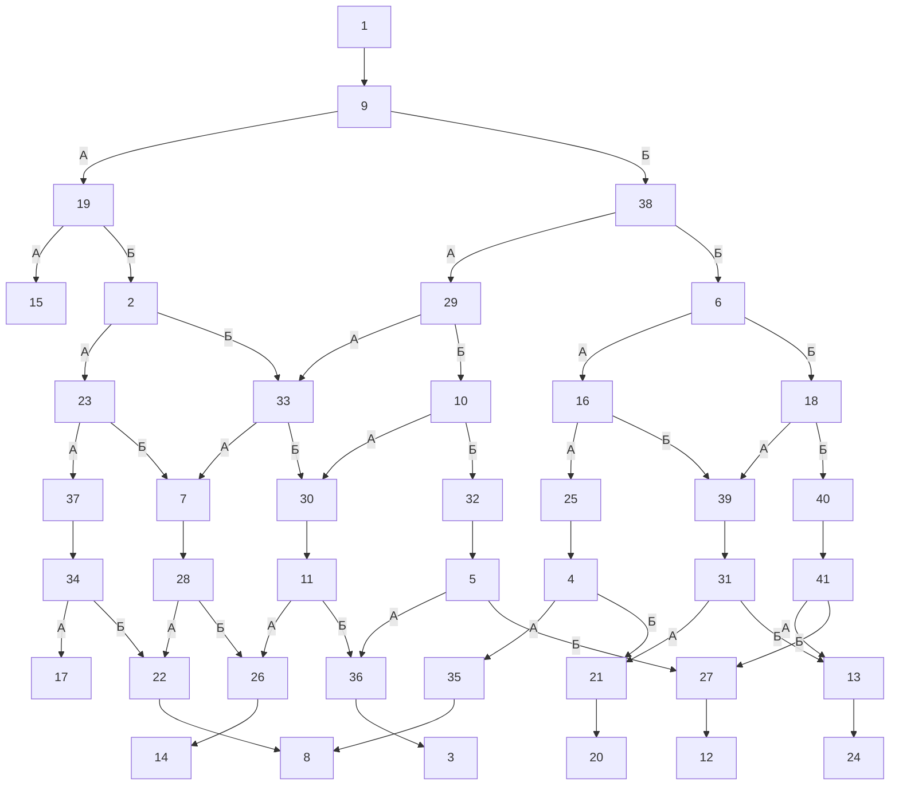

# storyGraph.md

Сцен: 41. Переходов: 51. Выборов: 18. Бросков: 0. Концовок: 8. Недостижимых: 0.

## Ветвления

| Сцена | Тип | Выходы |
|---|---|---|
| 1 | линейный | 9 |
| 2 | выбор | А → 23; Б → 33 |
| 3 | концовка | — |
| 4 | выбор | А → 35; Б → 21 |
| 5 | выбор | А → 36; Б → 27 |
| 6 | выбор | А → 16; Б → 18 |
| 7 | линейный | 28 |
| 8 | концовка | — |
| 9 | выбор | А → 19; Б → 38 |
| 10 | выбор | А → 30; Б → 32 |
| 11 | выбор | А → 26; Б → 36 |
| 12 | концовка | — |
| 13 | линейный | 24 |
| 14 | концовка | — |
| 15 | концовка | — |
| 16 | выбор | А → 25; Б → 39 |
| 17 | концовка | — |
| 18 | выбор | А → 39; Б → 40 |
| 19 | выбор | А → 15; Б → 2 |
| 20 | концовка | — |
| 21 | линейный | 20 |
| 22 | линейный | 8 |
| 23 | выбор | А → 37; Б → 7 |
| 24 | концовка | — |
| 25 | линейный | 4 |
| 26 | линейный | 14 |
| 27 | линейный | 12 |
| 28 | выбор | А → 22; Б → 26 |
| 29 | выбор | А → 33; Б → 10 |
| 30 | линейный | 11 |
| 31 | выбор | А → 21; Б → 13 |
| 32 | линейный | 5 |
| 33 | выбор | А → 7; Б → 30 |
| 34 | выбор | А → 17; Б → 22 |
| 35 | линейный | 8 |
| 36 | линейный | 3 |
| 37 | линейный | 34 |
| 38 | выбор | А → 29; Б → 6 |
| 39 | линейный | 31 |
| 40 | линейный | 41 |
| 41 | выбор | А → 13; Б → 27 |

## Концовки

| Сцена | Входящих | Чем кончается |
|---|---|---|
| 3 | 1 | выжил |
| 8 | 2 | голодал |
| 12 | 1 | выжил |
| 14 | 1 | голодал |
| 15 | 1 | спустил деньги в клубе |
| 17 | 1 | проиграл |
| 20 | 1 | выжил |
| 24 | 1 | выжил |

## Развилки (3+)

Нет: в книге каждая развилка — ровно два варианта.

## Хабы (топ-10 по входящим)

| Сцена | Входящих |
|---|---|
| 7 | 2 |
| 8 | 2 |
| 13 | 2 |
| 21 | 2 |
| 22 | 2 |
| 26 | 2 |
| 27 | 2 |
| 30 | 2 |
| 33 | 2 |
| 36 | 2 |

## Недостижимые

Нет: все 41 сцен достижимы из стартовой сцены 1.

## Граф

