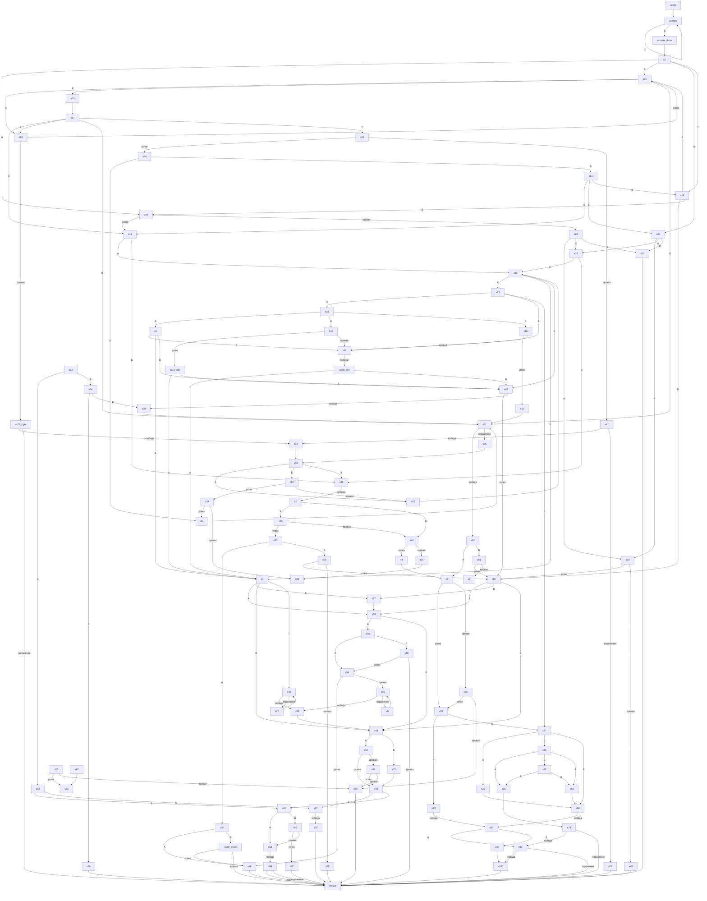

# storyGraph.md

Сцен: 108. Переходов: 193. Выборов: 37. Проверок: 22. Боёв: 14. Концовок: 4.

## Ветвления

| Сцена | Тип | Выходы |
|---|---|---|
| intro | линейный | create |
| create | выбор | А → create; Б → create; В → create; Г → create; Д → create_done |
| create_done | линейный | 1 |
| 1 | выбор | А → 44; Б → 31; В → 84; Г → 18 |
| 2 | выбор | А → 68; Б → 3; В → 47 |
| 3 | выбор | А → 28; Б → 67; В → 98; Г → 40 |
| 4 | линейный | 8 |
| 5 | линейный | 91 |
| 6 | концовка | — |
| 7 | выбор | А → 90; Б → 46 |
| 8 | проверка | успех → 26; провал → 75 |
| 9 | линейный | 96 |
| 10 | проверка | успех → s10_win; провал → 68 |
| 11 | линейный | 91 |
| 12 | линейный | 58 |
| 13 | бой | победа → 83; поражение → экран смерти |
| 14 | выбор | А → 56; Б → 38 |
| 15 | линейный | 97 |
| 16 | проверка | успех → 11; провал → 68 |
| 17 | линейный | 40 |
| 18 | выбор | А → 31; Б → 80; В → 44 |
| 19 | проверка | успех → 54; провал → result |
| 20 | линейный | 91 |
| 21 | выбор | А → 92; Б → 64 |
| 22 | линейный | 86 |
| 23 | выбор | А → 36; Б → 68; В → 77 |
| 24 | проверка | успех → 94; провал → 41 |
| 25 | линейный | 74 |
| 26 | выбор | А → 13; Б → 77 |
| 27 | выбор | А → 30; Б → 59 |
| 28 | выбор | А → 78; Б → 98 |
| 29 | линейный | result |
| 30 | выбор | А → 66; Б → s30_check |
| 31 | выбор | А → 73; Б → 15; В → 91 |
| 32 | выбор | А → 25; Б → 51 |
| 33 | концовка | — |
| 34 | проверка | успех → 5; провал → 99 |
| 35 | линейный | 58 |
| 36 | выбор | А → 2; Б → 10; В → 16 |
| 37 | проверка | успех → 95; провал → 69 |
| 38 | бой | победа → 7; поражение → экран смерти |
| 39 | проверка | успех → 80; провал → 45 |
| 40 | бой | победа → 85; поражение → 17 |
| 41 | бой | победа → 12; поражение → 29 |
| 42 | выбор | А → 53; Б → 62 |
| 43 | выбор | А → 25; Б → 32; В → 51 |
| 44 | проверка | успех → 14; провал → 88 |
| 45 | линейный | result |
| 46 | проверка | успех → 4; провал → 60 |
| 47 | проверка | успех → 80; провал → 20 |
| 48 | проверка | успех → 95; провал → 37 |
| 49 | линейный | 100 |
| 50 | линейный | result |
| 51 | линейный | 86 |
| 52 | линейный | 56 |
| 53 | бой | победа → 89; поражение → экран смерти |
| 54 | проверка | успех → 66; провал → 96 |
| 55 | проверка | успех → 33; провал → 69 |
| 56 | выбор | А → 23; Б → 3; В → 47 |
| 57 | бой | победа → 76; поражение → экран смерти |
| 58 | выбор | А → 52; Б → 87; В → 38 |
| 59 | проверка | успех → 80; провал → 70 |
| 60 | линейный | 99 |
| 61 | выбор | А → 14; Б → 84; В → 18 |
| 62 | проверка | успех → 82; провал → 53 |
| 63 | выбор | А → 8; Б → 81 |
| 64 | выбор | А → 50; Б → 20 |
| 65 | линейный | 33 |
| 66 | линейный | result |
| 67 | линейный | 28 |
| 68 | бой | победа → s68_win; поражение → экран смерти |
| 69 | линейный | result |
| 70 | линейный | result |
| 71 | линейный | result |
| 72 | линейный | 95 |
| 73 | проверка | успех → 31; провал → s73_fight |
| 74 | бой | победа → 93; поражение → result |
| 75 | проверка | успех → 26; провал → 69 |
| 76 | линейный | result |
| 77 | выбор | А → 22; Б → 43; В → 86 |
| 78 | выбор | А → 54; Б → 19 |
| 79 | выбор | А → 56; Б → 38 |
| 80 | выбор | А → 28; Б → 67; В → 98 |
| 81 | проверка | успех → 80; провал → 6 |
| 82 | линейный | result |
| 83 | выбор | А → 93; Б → 49 |
| 84 | выбор | А → 39; Б → 79; В → 71 |
| 85 | линейный | 98 |
| 86 | бой | победа → 83; поражение → экран смерти |
| 87 | проверка | успех → 34; провал → 52 |
| 88 | выбор | А → 39; Б → 79; В → 71 |
| 89 | бой | победа → result; поражение → result |
| 90 | проверка | успех → 27; провал → 46 |
| 91 | бой | победа → 63; поражение → 35 |
| 92 | выбор | А → 42; Б → 57 |
| 93 | бой | победа → 100; поражение → result |
| 94 | выбор | А → 5; Б → 61 |
| 95 | выбор | А → 57; Б → 42 |
| 96 | бой | победа → 85; поражение → 9 |
| 97 | выбор | А → 14; Б → 73; В → 91; Г → 24 |
| 98 | выбор | А → 48; Б → 72 |
| 99 | концовка | — |
| 100 | линейный | result |
| s10_win | выбор | А → 3; Б → 47 |
| s30_check | проверка | успех → 66; провал → result |
| s68_win | выбор | А → 3; Б → 47 |
| s73_fight | бой | победа → 12; поражение → result |
| result | концовка | — |

## Концовки

| Сцена | Входящих |
|---|---|
| 6 | 1 |
| 33 | 2 |
| 99 | 2 |
| result | 17 |

## Недостижимые

21, 33, 50, 55, 64, 65, 92

## Хабы (топ-10 по входящим)

| Сцена | Входящих |
|---|---|
| result | 17 |
| 80 | 5 |
| 91 | 5 |
| create | 5 |
| 3 | 4 |
| 47 | 4 |
| 68 | 4 |
| 98 | 4 |
| 14 | 3 |
| 28 | 3 |

## Граф

