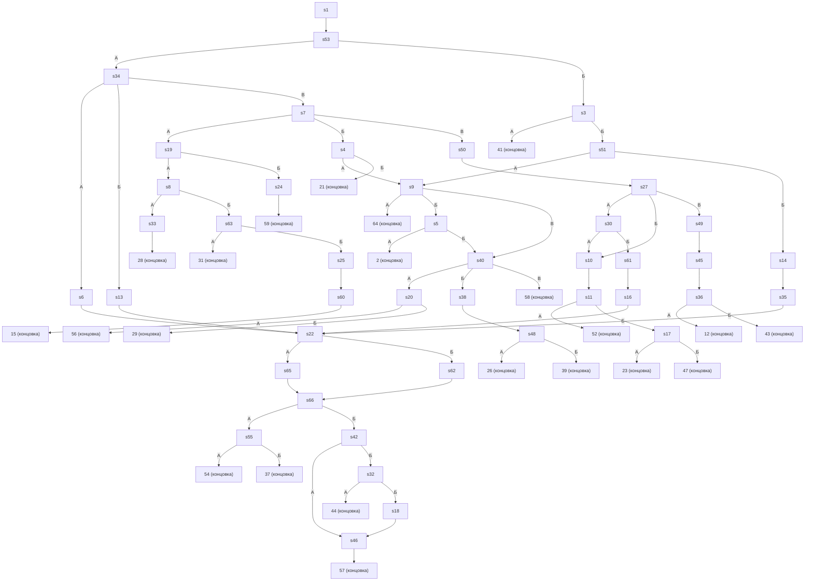

# storyGraph.md

Сцен: 66. Переходов: 73. Сцен с выбором: 24. Бросков: 0. Концовок: 22. Недостижимых: 0.

Файл производный: построен по `story.md` и `game.yaml`, вручную не правится.

## Ветвления

| Сцена | Тип | Выходы |
|---|---|---|
| 1 | линейный | 53 |
| 2 | концовка | — |
| 3 | выбор | А → 41; Б → 51 |
| 4 | выбор | А → 9; Б → 21 |
| 5 | выбор | А → 2; Б → 40 |
| 6 | линейный | 22 |
| 7 | выбор | А → 19; Б → 4; В → 50 |
| 8 | выбор | А → 33; Б → 63 |
| 9 | выбор | А → 64; Б → 5; В → 40 |
| 10 | линейный | 11 |
| 11 | выбор | А → 52; Б → 17 |
| 12 | концовка | — |
| 13 | линейный | 22 |
| 14 | линейный | 35 |
| 15 | концовка | — |
| 16 | линейный | 22 |
| 17 | выбор | А → 23; Б → 47 |
| 18 | линейный | 46 |
| 19 | выбор | А → 8; Б → 24 |
| 20 | выбор | А → 56; Б → 29 |
| 21 | концовка | — |
| 22 | выбор | А → 65; Б → 62 |
| 23 | концовка | — |
| 24 | линейный | 59 |
| 25 | линейный | 60 |
| 26 | концовка | — |
| 27 | выбор | А → 30; Б → 10; В → 49 |
| 28 | концовка | — |
| 29 | концовка | — |
| 30 | выбор | А → 10; Б → 61 |
| 31 | концовка | — |
| 32 | выбор | А → 44; Б → 18 |
| 33 | линейный | 28 |
| 34 | выбор | А → 6; Б → 13; В → 7 |
| 35 | линейный | 22 |
| 36 | выбор | А → 12; Б → 43 |
| 37 | концовка | — |
| 38 | линейный | 48 |
| 39 | концовка | — |
| 40 | выбор | А → 20; Б → 38; В → 58 |
| 41 | концовка | — |
| 42 | выбор | А → 46; Б → 32 |
| 43 | концовка | — |
| 44 | концовка | — |
| 45 | линейный | 36 |
| 46 | линейный | 57 |
| 47 | концовка | — |
| 48 | выбор | А → 26; Б → 39 |
| 49 | линейный | 45 |
| 50 | линейный | 27 |
| 51 | выбор | А → 9; Б → 14 |
| 52 | концовка | — |
| 53 | выбор | А → 34; Б → 3 |
| 54 | концовка | — |
| 55 | выбор | А → 54; Б → 37 |
| 56 | концовка | — |
| 57 | концовка | — |
| 58 | концовка | — |
| 59 | концовка | — |
| 60 | линейный | 15 |
| 61 | линейный | 16 |
| 62 | линейный | 66 |
| 63 | выбор | А → 31; Б → 25 |
| 64 | концовка | — |
| 65 | линейный | 66 |
| 66 | выбор | А → 55; Б → 42 |

## Концовки

| Сцена | Входящих |
|---|---|
| 2 | 1 |
| 12 | 1 |
| 15 | 1 |
| 21 | 1 |
| 23 | 1 |
| 26 | 1 |
| 28 | 1 |
| 29 | 1 |
| 31 | 1 |
| 37 | 1 |
| 39 | 1 |
| 41 | 1 |
| 43 | 1 |
| 44 | 1 |
| 47 | 1 |
| 52 | 1 |
| 54 | 1 |
| 56 | 1 |
| 57 | 1 |
| 58 | 1 |
| 59 | 1 |
| 64 | 1 |

## Развилки (3+)

| Сцена | Выходов |
|---|---|
| 7 | 3 |
| 9 | 3 |
| 27 | 3 |
| 34 | 3 |
| 40 | 3 |

## Хабы (топ-10 по входящим)

| Сцена | Входящих |
|---|---|
| 22 | 4 |
| 9 | 2 |
| 10 | 2 |
| 40 | 2 |
| 46 | 2 |
| 66 | 2 |
| 2 | 1 |
| 3 | 1 |
| 4 | 1 |
| 5 | 1 |

## Недостижимые

Нет: из стартовой сцены `1` достижимы все 66 сцен и все 22 концовок (BFS по прямым рёбрам).

## Граф

