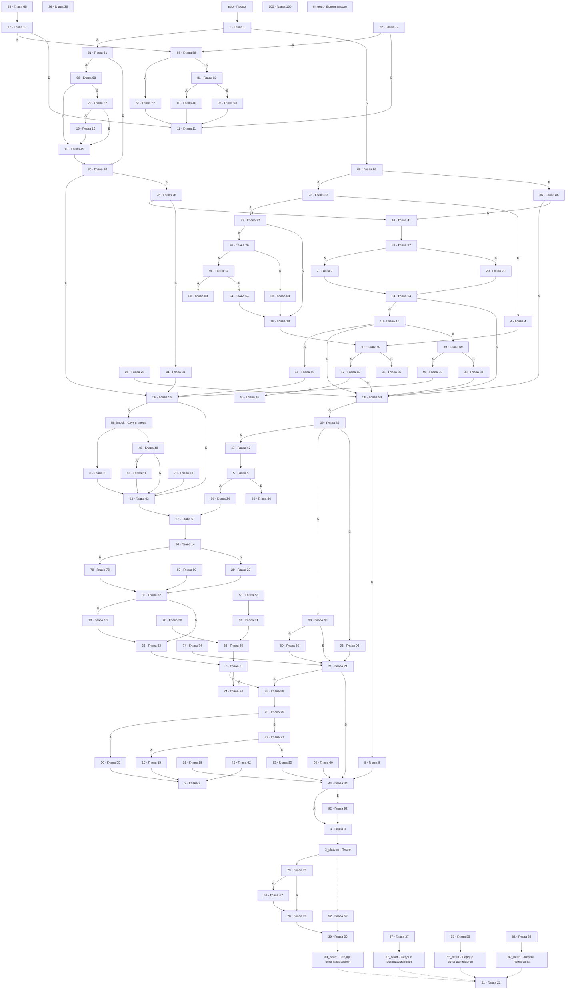

# storyGraph.md

Сцен: 108. Переходов: 137 (+107 защитных в timeout). Выборов: 36. Бросков: 0. Концовок: 15. Недостижимых прямыми рёбрами: 28. С кодами достижимо: 108 из 108.

## Ветвления

| Сцена | Тип | Выходы |
|---|---|---|
| intro | линейный | 1 |
| 1 | выбор | А → 51; Б → 66 |
| 2 | концовка | — |
| 3 | линейный | 3_plateau |
| 3_plateau | линейный | 79; если stat time > 660 → 52 |
| 4 | линейный | 97 |
| 5 | выбор | А → 34; Б → 84 |
| 6 | линейный | 43 |
| 7 | линейный | 64 |
| 8 | выбор | А → 88; Б → 24 |
| 9 | линейный | 44 |
| 10 | выбор | А → 45; Б → 58; В → 59 |
| 11 | концовка | — |
| 12 | выбор | А → 46; Б → 58 |
| 13 | линейный | 33 |
| 14 | выбор | А → 78; Б → 29 |
| 15 | линейный | 2 |
| 16 | линейный | 49 |
| 17 | выбор | А → 98; Б → 11 |
| 18 | линейный | 97 |
| 19 | линейный | 44 |
| 20 | линейный | 64 |
| 21 | концовка | — |
| 22 | выбор | А → 16; Б → 49 |
| 23 | выбор | А → 77; Б → 4 |
| 24 | концовка | — |
| 25 | линейный | 58 |
| 26 | выбор | А → 94; Б → 63 |
| 27 | выбор | А → 15; Б → 95 |
| 28 | линейный | 85 |
| 29 | линейный | 32 |
| 30 | линейный | 30_heart |
| 30_heart | концовка | — |
| 31 | линейный | 56 |
| 32 | выбор | А → 13; Б → 33 |
| 33 | линейный | 8 |
| 34 | линейный | 57 |
| 35 | концовка | — |
| 36 | концовка | — |
| 37 | линейный | 37_heart |
| 37_heart | концовка | — |
| 38 | линейный | 58 |
| 39 | выбор | А → 47; Б → 99; В → 96 |
| 40 | линейный | 11 |
| 41 | линейный | 87 |
| 42 | линейный | 2 |
| 43 | линейный | 57 |
| 44 | выбор | А → 3; Б → 92 |
| 45 | линейный | 56 |
| 46 | концовка | — |
| 47 | линейный | 5 |
| 48 | выбор | А → 61; Б → 43 |
| 49 | линейный | 80 |
| 50 | линейный | 2 |
| 51 | выбор | А → 68; Б → 80 |
| 52 | линейный | 30 |
| 53 | линейный | 91 |
| 54 | линейный | 18 |
| 55 | линейный | 55_heart |
| 55_heart | концовка | — |
| 56 | выбор | А → 56_knock; Б → 43 |
| 56_knock | линейный | 6; если stat time > 240 → 48 |
| 57 | линейный | 14 |
| 58 | выбор | А → 39; Б → 9 |
| 59 | выбор | А → 90; Б → 38 |
| 60 | линейный | 44 |
| 61 | линейный | 43 |
| 62 | линейный | 11 |
| 63 | линейный | 18 |
| 64 | выбор | А → 10; Б → 58 |
| 65 | линейный | 17 |
| 66 | выбор | А → 23; Б → 86 |
| 67 | линейный | 70 |
| 68 | выбор | А → 49; Б → 22 |
| 69 | линейный | 32 |
| 70 | линейный | 30 |
| 71 | выбор | А → 88; Б → 44 |
| 72 | выбор | А → 98; Б → 11 |
| 73 | линейный | 43 |
| 74 | линейный | 71 |
| 75 | выбор | А → 50; Б → 27 |
| 76 | выбор | А → 41; Б → 31 |
| 77 | выбор | А → 26; Б → 18 |
| 78 | линейный | 32 |
| 79 | выбор | А → 67; Б → 70 |
| 80 | выбор | А → 56; Б → 76 |
| 81 | выбор | А → 40; Б → 93 |
| 82 | линейный | 82_heart |
| 82_heart | концовка | — |
| 83 | концовка | — |
| 84 | концовка | — |
| 85 | линейный | 8 |
| 86 | выбор | А → 58; Б → 41 |
| 87 | выбор | А → 7; Б → 20 |
| 88 | линейный | 75 |
| 89 | линейный | 71 |
| 90 | линейный | 56 |
| 91 | линейный | 85 |
| 92 | линейный | 3 |
| 93 | линейный | 11 |
| 94 | выбор | А → 83; Б → 54 |
| 95 | линейный | 44 |
| 96 | линейный | 71 |
| 97 | выбор | А → 12; Б → 35 |
| 98 | выбор | А → 62; Б → 81 |
| 99 | выбор | А → 89; Б → 71 |
| 100 | концовка | — |
| timeout | концовка | — |

## Концовки

| Сцена | Входящих |
|---|---|
| 2 | 3 |
| 11 | 5 |
| 21 | 4 |
| 24 | 1 |
| 30_heart | 1 |
| 35 | 1 |
| 36 | 0 |
| 37_heart | 1 |
| 46 | 1 |
| 55_heart | 1 |
| 82_heart | 1 |
| 83 | 1 |
| 84 | 1 |
| 100 | 0 |
| timeout | 107 защитных |

Прямых входящих нет у концовок 36 и 100: §36 достижим кодом `mirror` (§24 + 12), §100 — кодом `witch_name` (§70 + 30). Это не потерянные концовки, а динамические переходы.

## Защитный переход (12 часов)

Все сцены, кроме `timeout`, при `stat time > 720` ведут в `timeout` — 107 рёбер. На Mermaid-графе они не дублируются, чтобы не рисовать 107 одинаковых дуг; проверка стоит в `on_enter` каждой сцены.

## Развилки (3+)

| Сцена | Выходов |
|---|---|
| 10 | 3 |
| 39 | 3 |

## Хабы (топ-10 по входящим)

| Сцена | Входящих |
|---|---|
| 58 | 6 |
| 11 | 5 |
| 43 | 5 |
| 44 | 5 |
| 21 | 4 |
| 56 | 4 |
| 71 | 4 |
| 2 | 3 |
| 18 | 3 |
| 32 | 3 |

## Коды

| Код | Смещение | Где выдан | Где применяется по подсказке книги |
|---|---|---|---|
| `anna` (Анна, дочь лесоруба) | -8 | §6 (лесоруб называет имя дочери), §73 (жена лесоруба просит найти Анну) | §27 → §19, §50 → §42 |
| `old_woman` (Хижина старухи) | +20 | §6 (совет лесоруба навестить старуху) | §33 → §53 |
| `crucifix` (Золотое распятие с рубином) | +10 | §7 (распятие в руке после сна) | §50 → §60 |
| `mirror` (Зеркало Джеймса Маррела) | +12 | §20 (зеркало в руке после сна) | §24 → §36, §53 → §65, §57 → §69, §61 → §73 |
| `medallion` (Бронзовый медальон с корабликом) | -10 | §54 (медальон в затопленном погребе) | §35 → §25, §84 → §74 |
| `dream_death` (Пробуждение от смерти во сне) | +17 | §65 (старуха усыпляет героя) | §11 → §28 |
| `wife_name` (Имя жены — Августина) | -15 | §91 (старуха называет имя) | §52 → §37, §70 → §55 |
| `witch_name` (Имя ведьмы из Книги Теней) | +30 | §93 (имя «Гринаила» в Книге Теней) | §52 → §82, §70 → §100 |
| `atso_place` (Тайный вход у западного склона) | -20 | §99 (Ацо рассказывает о входе) | §92 → §72 |

## Недостижимые прямыми рёбрами

Достижимы только применением кода (см. таблицу «Коды»): 11, 17, 19, 25, 28, 36, 37, 37_heart, 40, 42, 53, 55, 55_heart, 60, 62, 65, 69, 72, 73, 74, 81, 82, 82_heart, 85, 91, 93, 98, 100.

## Граф

