# storyGraph.md

Сцен: 53. Переходов: 120. Выборов: 10. Бросков: 6. Концовок: 2. Недостижимых: 0.

Служебные узлы (`s*`, `fish_*`) — меню и узлы отметок: их текст — это строки вариантов или пустая строка, новых слов в них нет.

## Ветвления

| Сцена | Тип | Выходы |
|---|---|---|
| 1 | выбор | А → 1; Б → 1; В → 1; Г → 1; Д → 1; Е → 1; Ж → 1; З → 11; И → 15 |
| 2 | линейный | 11 |
| 3 | бросок | 1d3: ≥3 → s3_both; ≥2 → s3_no; иначе → s3_yes |
| 4 | линейный | 11 |
| 5 | бросок | 1d3: ≥3 → s5_both; ≥2 → s5_no; иначе → s5_yes |
| 6 | бросок | 1d3: ≥3 → s6_both; ≥2 → s6_rudd; иначе → s6_carp |
| 7 | линейный | 4 |
| 8 | бросок | 1d15: ≥15 → fish_set_15; ≥14 → fish_set_14; ≥13 → fish_set_13; ≥12 → fish_set_12; ≥11 → fish_set_11; ≥10 → fish_set_10; ≥9 → fish_set_09; ≥8 → fish_set_08; ≥7 → fish_set_07; ≥6 → fish_set_06; ≥5 → fish_set_05; ≥4 → fish_set_04; ≥3 → fish_set_03; ≥2 → fish_set_02; иначе → fish_set_01 |
| 9 | бросок | 1d15: ≥15 → fish_set_15; ≥14 → fish_set_14; ≥13 → fish_set_13; ≥12 → fish_set_12; ≥11 → fish_set_11; ≥10 → fish_set_10; ≥9 → fish_set_09; ≥8 → fish_set_08; ≥7 → fish_set_07; ≥6 → fish_set_06; ≥5 → fish_set_05; ≥4 → fish_set_04; ≥3 → fish_set_03; ≥2 → fish_set_02; иначе → fish_set_01 |
| 10 | выбор | А → 3; Б → 2 |
| 11 | выбор | А → 1; Б → 5; В → 5; Г → 5; Д → 5; Е → 5; Ж → 5; З → 5 |
| 12 | бросок | 1d3: ≥3 → s12_both; ≥2 → s12_roach; иначе → s12_rudd |
| 13 | линейный | 11 |
| 14 | линейный | 16 |
| 15 | концовка | — |
| 16 | линейный | 11 |
| 17 | концовка | — |
| 18 | выбор | А → 11; Б → 11 |
| 19 | выбор | А → 9; Б → 14; В → 7; Г → 8; Д → 6; Е → 12; Ж → 20 |
| 20 | линейный | 13 |
| 21 | линейный | 11 |
| s3_yes | линейный | s3_menu |
| s3_no | линейный | s3_menu |
| s3_both | линейный | s3_menu |
| s3_menu | выбор | А → 19; Б → 2; В → 19 |
| s5_yes | линейный | s5_menu |
| s5_no | линейный | s5_menu |
| s5_both | линейный | s5_menu |
| s5_menu | выбор | А → 10; Б → 5; В → 11; Г → 17 |
| s6_carp | линейный | s6_menu |
| s6_rudd | линейный | s6_menu |
| s6_both | линейный | s6_menu |
| s6_menu | выбор | А → 13; Б → 21 |
| fish_set_01 | линейный | fish_menu |
| fish_set_02 | линейный | fish_menu |
| fish_set_03 | линейный | fish_menu |
| fish_set_04 | линейный | fish_menu |
| fish_set_05 | линейный | fish_menu |
| fish_set_06 | линейный | fish_menu |
| fish_set_07 | линейный | fish_menu |
| fish_set_08 | линейный | fish_menu |
| fish_set_09 | линейный | fish_menu |
| fish_set_10 | линейный | fish_menu |
| fish_set_11 | линейный | fish_menu |
| fish_set_12 | линейный | fish_menu |
| fish_set_13 | линейный | fish_menu |
| fish_set_14 | линейный | fish_menu |
| fish_set_15 | линейный | fish_menu |
| fish_menu | выбор | А → 16; Б → 13; В → 21; Г → 18 |
| s12_rudd | линейный | s12_menu |
| s12_roach | линейный | s12_menu |
| s12_both | линейный | s12_menu |
| s12_menu | выбор | А → 21; Б → 18 |

## Концовки

| Сцена | Входящих |
|---|---|
| 15 | 1 |
| 17 | 1 |

## Развилки (3+)

| Сцена | Выходов |
|---|---|
| 1 | 9 |
| 11 | 8 |
| 19 | 7 |
| s5_menu | 4 |
| fish_menu | 4 |
| s3_menu | 3 |

## Хабы (топ-10 по входящим)

| Сцена | Входящих |
|---|---|
| fish_menu | 15 |
| 11 | 9 |
| 1 | 8 |
| 5 | 8 |
| 13 | 3 |
| 21 | 3 |
| s3_menu | 3 |
| s5_menu | 3 |
| s6_menu | 3 |
| s12_menu | 3 |

## Недостижимые

Нет: все 53 сцены достижимы из `1` (проверено обходом и симуляцией).

## Граф

```mermaid
flowchart TD
  n0["1"]
  n1["2"]
  n2["3"]
  n3["4"]
  n4["5"]
  n5["6"]
  n6["7"]
  n7["8"]
  n8["9"]
  n9["10"]
  n10["11"]
  n11["12"]
  n12["13"]
  n13["14"]
  n14["15"]
  n15["16"]
  n16["17"]
  n17["18"]
  n18["19"]
  n19["20"]
  n20["21"]
  n21["s3_yes (служ.)"]
  n22["s3_no (служ.)"]
  n23["s3_both (служ.)"]
  n24["s3_menu (служ.)"]
  n25["s5_yes (служ.)"]
  n26["s5_no (служ.)"]
  n27["s5_both (служ.)"]
  n28["s5_menu (служ.)"]
  n29["s6_carp (служ.)"]
  n30["s6_rudd (служ.)"]
  n31["s6_both (служ.)"]
  n32["s6_menu (служ.)"]
  n33["fish_set_01 (служ.)"]
  n34["fish_set_02 (служ.)"]
  n35["fish_set_03 (служ.)"]
  n36["fish_set_04 (служ.)"]
  n37["fish_set_05 (служ.)"]
  n38["fish_set_06 (служ.)"]
  n39["fish_set_07 (служ.)"]
  n40["fish_set_08 (служ.)"]
  n41["fish_set_09 (служ.)"]
  n42["fish_set_10 (служ.)"]
  n43["fish_set_11 (служ.)"]
  n44["fish_set_12 (служ.)"]
  n45["fish_set_13 (служ.)"]
  n46["fish_set_14 (служ.)"]
  n47["fish_set_15 (служ.)"]
  n48["fish_menu (служ.)"]
  n49["s12_rudd (служ.)"]
  n50["s12_roach (служ.)"]
  n51["s12_both (служ.)"]
  n52["s12_menu (служ.)"]
  n0 -->|А| n0
  n0 -->|Б| n0
  n0 -->|В| n0
  n0 -->|Г| n0
  n0 -->|Д| n0
  n0 -->|Е| n0
  n0 -->|Ж| n0
  n0 -->|З| n10
  n0 -->|И| n14
  n1 --> n10
  n2 -->|≥3| n23
  n2 -->|≥2| n22
  n2 -->|иначе| n21
  n3 --> n10
  n4 -->|≥3| n27
  n4 -->|≥2| n26
  n4 -->|иначе| n25
  n5 -->|≥3| n31
  n5 -->|≥2| n30
  n5 -->|иначе| n29
  n6 --> n3
  n7 -->|≥15| n47
  n7 -->|≥14| n46
  n7 -->|≥13| n45
  n7 -->|≥12| n44
  n7 -->|≥11| n43
  n7 -->|≥10| n42
  n7 -->|≥9| n41
  n7 -->|≥8| n40
  n7 -->|≥7| n39
  n7 -->|≥6| n38
  n7 -->|≥5| n37
  n7 -->|≥4| n36
  n7 -->|≥3| n35
  n7 -->|≥2| n34
  n7 -->|иначе| n33
  n8 -->|≥15| n47
  n8 -->|≥14| n46
  n8 -->|≥13| n45
  n8 -->|≥12| n44
  n8 -->|≥11| n43
  n8 -->|≥10| n42
  n8 -->|≥9| n41
  n8 -->|≥8| n40
  n8 -->|≥7| n39
  n8 -->|≥6| n38
  n8 -->|≥5| n37
  n8 -->|≥4| n36
  n8 -->|≥3| n35
  n8 -->|≥2| n34
  n8 -->|иначе| n33
  n9 -->|А| n2
  n9 -->|Б| n1
  n10 -->|А| n0
  n10 -->|Б| n4
  n10 -->|В| n4
  n10 -->|Г| n4
  n10 -->|Д| n4
  n10 -->|Е| n4
  n10 -->|Ж| n4
  n10 -->|З| n4
  n11 -->|≥3| n51
  n11 -->|≥2| n50
  n11 -->|иначе| n49
  n12 --> n10
  n13 --> n15
  n15 --> n10
  n17 -->|А| n10
  n17 -->|Б| n10
  n18 -->|А| n8
  n18 -->|Б| n13
  n18 -->|В| n6
  n18 -->|Г| n7
  n18 -->|Д| n5
  n18 -->|Е| n11
  n18 -->|Ж| n19
  n19 --> n12
  n20 --> n10
  n21 --> n24
  n22 --> n24
  n23 --> n24
  n24 -->|А| n18
  n24 -->|Б| n1
  n24 -->|В| n18
  n25 --> n28
  n26 --> n28
  n27 --> n28
  n28 -->|А| n9
  n28 -->|Б| n4
  n28 -->|В| n10
  n28 -->|Г| n16
  n29 --> n32
  n30 --> n32
  n31 --> n32
  n32 -->|А| n12
  n32 -->|Б| n20
  n33 --> n48
  n34 --> n48
  n35 --> n48
  n36 --> n48
  n37 --> n48
  n38 --> n48
  n39 --> n48
  n40 --> n48
  n41 --> n48
  n42 --> n48
  n43 --> n48
  n44 --> n48
  n45 --> n48
  n46 --> n48
  n47 --> n48
  n48 -->|А| n15
  n48 -->|Б| n12
  n48 -->|В| n20
  n48 -->|Г| n17
  n49 --> n52
  n50 --> n52
  n51 --> n52
  n52 -->|А| n20
  n52 -->|Б| n17
```

