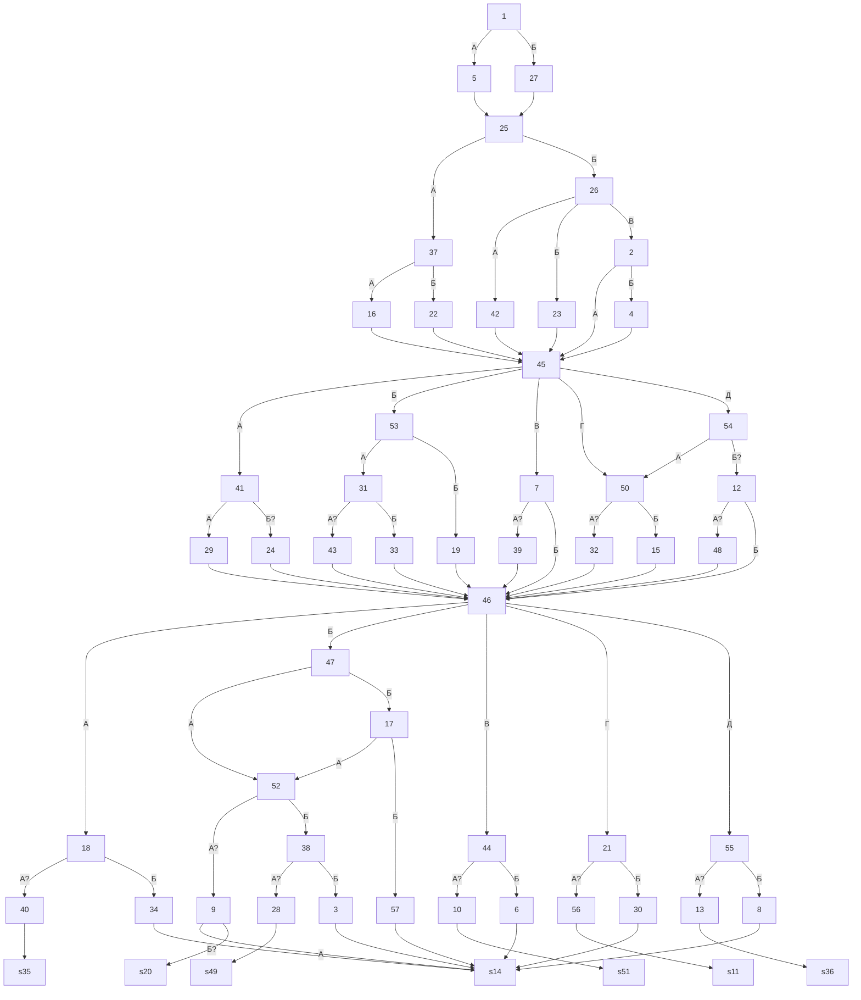

# storyGraph.md

Сцен: 57. Переходов: 80. Выборов: 53 (в 23 сценах). Линейных переходов: 27. Бросков: 0. Концовок: 7. Недостижимых: 0. Флагов: 9.

## Ветвления

| Сцена | Тип | Выходы |
|---|---|---|
| 1 | выбор | А → 5; Б → 27 |
| 2 | выбор | А → 45; Б → 4 |
| 3 | линейный | 14 |
| 4 | линейный | 45 |
| 5 | линейный | 25 |
| 6 | линейный | 14 |
| 7 | выбор | А → 39 (если flag ars_walk); Б → 46 |
| 8 | линейный | 14 |
| 9 | выбор | А → 14; Б → 20 (если flag ilya_truth and flag gera_kiss) |
| 10 | линейный | 51 |
| 11 | концовка | — |
| 12 | выбор | А → 48 (если flag kirill_question); Б → 46 |
| 13 | линейный | 36 |
| 14 | концовка | — |
| 15 | линейный | 46 |
| 16 | линейный | 45 |
| 17 | выбор | А → 52; Б → 57 |
| 18 | выбор | А → 40 (если flag vlad_kiss); Б → 34 |
| 19 | линейный | 46 |
| 20 | концовка | — |
| 21 | выбор | А → 56 (если flag ars_kiss); Б → 30 |
| 22 | линейный | 45 |
| 23 | линейный | 45 |
| 24 | линейный | 46 |
| 25 | выбор | А → 37; Б → 26 |
| 26 | выбор | А → 42; Б → 23; В → 2 |
| 27 | линейный | 25 |
| 28 | линейный | 49 |
| 29 | линейный | 46 |
| 30 | линейный | 14 |
| 31 | выбор | А → 43 (если flag vlad_talk); Б → 33 |
| 32 | линейный | 46 |
| 33 | линейный | 46 |
| 34 | линейный | 14 |
| 35 | концовка | — |
| 36 | концовка | — |
| 37 | выбор | А → 16; Б → 22 |
| 38 | выбор | А → 28 (если flag ilya_forest); Б → 3 |
| 39 | линейный | 46 |
| 40 | линейный | 35 |
| 41 | выбор | А → 29; Б → 24 (если flag ilya_truth) |
| 42 | линейный | 45 |
| 43 | линейный | 46 |
| 44 | выбор | А → 10 (если flag kirill_kiss); Б → 6 |
| 45 | выбор | А → 41; Б → 53; В → 7; Г → 50; Д → 54 |
| 46 | выбор | А → 18; Б → 47; В → 44; Г → 21; Д → 55 |
| 47 | выбор | А → 52; Б → 17 |
| 48 | линейный | 46 |
| 49 | концовка | — |
| 50 | выбор | А → 32 (если flag ilya_truth); Б → 15 |
| 51 | концовка | — |
| 52 | выбор | А → 9 (если flag ilya_truth); Б → 38 |
| 53 | выбор | А → 31; Б → 19 |
| 54 | выбор | А → 50; Б → 12 (если flag kirill_question) |
| 55 | выбор | А → 13 (если flag gera_kiss); Б → 8 |
| 56 | линейный | 11 |
| 57 | линейный | 14 |

## Концовки

| Сцена | Входящих |
|---|---|
| 11 | 1 |
| 14 | 7 |
| 20 | 1 |
| 35 | 1 |
| 36 | 1 |
| 49 | 1 |
| 51 | 1 |

## Развилки (3+)

| Сцена | Выходов |
|---|---|
| 26 | 3 |
| 45 | 5 |
| 46 | 5 |

## Хабы (топ-10 по входящим)

| Сцена | Входящих |
|---|---|
| 46 | 11 |
| 14 | 7 |
| 45 | 6 |
| 25 | 2 |
| 50 | 2 |
| 52 | 2 |
| 2 | 1 |
| 3 | 1 |
| 4 | 1 |
| 5 | 1 |

## Недостижимые

Нет: все 57 сцен достижимы из старта с учётом условий на флагах.

## Граф

