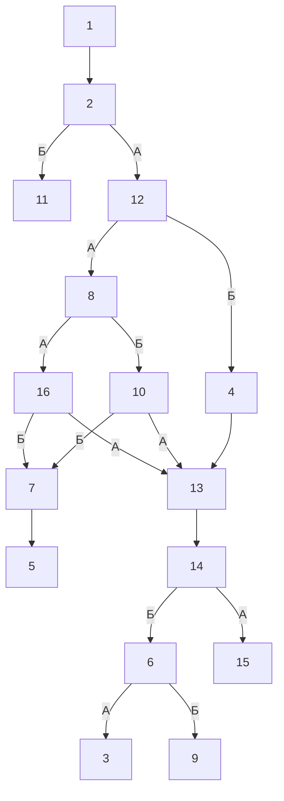

# storyGraph.md

Сцен: 16. Переходов: 18. Выборов: 7. Бросков: 0. Концовок: 5. Недостижимых: 0.

## Ветвления

| Сцена | Тип | Выходы |
|---|---|---|
| 1 | линейный | 2 |
| 2 | выбор | А → 12; Б → 11 |
| 3 | концовка | — |
| 4 | линейный | 13 |
| 5 | концовка | — |
| 6 | выбор | А → 3; Б → 9 |
| 7 | линейный | 5 |
| 8 | выбор | А → 16; Б → 10 |
| 9 | концовка | — |
| 10 | выбор | А → 13; Б → 7 |
| 11 | концовка | — |
| 12 | выбор | А → 8; Б → 4 |
| 13 | линейный | 14 |
| 14 | выбор | А → 15; Б → 6 |
| 15 | концовка | — |
| 16 | выбор | А → 13; Б → 7 |

## Концовки

| Сцена | Входящих |
|---|---|
| 3 | 1 |
| 5 | 1 |
| 9 | 1 |
| 11 | 1 |
| 15 | 1 |

## Развилки (3+)

Нет сцен с тремя и более выходами.

## Хабы (топ-10 по входящим)

| Сцена | Входящих |
|---|---|
| 13 | 3 |
| 7 | 2 |

## Недостижимые

Нет: все 16 сцен достижимы из стартовой сцены 1.

## Граф

